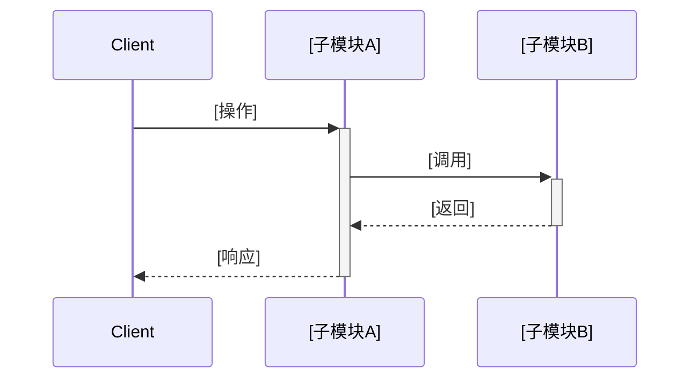
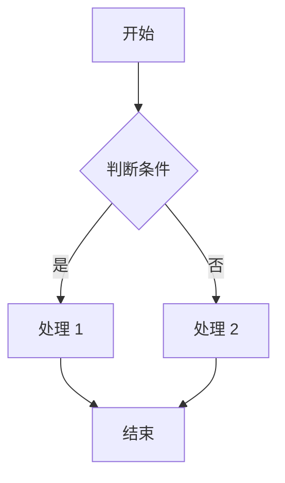

# 模块概要设计说明书（AI 填写模板）

> **模板用途**：供 AI 编写符合公司评审标准（SFRD-TS-02-3.6）的概要设计文档
> **对应规范**：SFRD-TS-02-3.6（V3.6）
> **质量标准**：设计目标达成(40%) + 安全性(10%) + 可靠性(10%) + 可调试/测试/运维(10%) + 易实现性(10%) + 可扩展/复用(10%) + 文档规范(10%)
> **红线约束**：安全性章节、可靠性章节不得缺失；缺章节≥3 直接定级 C；必须有 checklist 自检

---

## 文档信息

| 项目 | 内容 |
|------|------|
| 模块名称 | [模块名称] |
| 版本号 | V1.0 |
| 作者 | [作者] |
| 日期 | [YYYY-MM-DD] |
| 评审状态 | 待评审 |

---

## 0. 设计方法说明（AI 工作指引）

> **仅供 AI 参考，交付时删除本节**
>
> **概设输入**：总体设计划分的模块 + 该模块对外接口 + 该模块系统流程
> **概设输出**：全局数据结构定义 + 接口流程图 + 实现接口的所有内部函数（功能、流程图）
>
> **AI 填写顺序**（避免来回修改）：
> 1. 先写「2. 设计任务书」——明确所有需求点和目标（输入）
> 2. 再写「4.2 方案选型」——方案确定前不展开细节
> 3. 然后写「4.3 静态结构」和「4.5 概要流程」——整体蓝图
> 4. 再写「6. 流程设计」各子模块——从上到下逐步细化
> 5. 最后写 DFX 特性（安全/可靠/可测试）和总结
>
> **评分重点**（AI 必须特别注意）：
> - **设计目标达成(40%)**：每个需求点必须有明确实现方案，编码人员按设计能完整实现
> - **安全性(10%)**：不得以"不涉及"敷衍，必须分析威胁并给出机制
> - **可靠性(10%)**：必须分析异常场景，给出检测/恢复方案
> - **文档规范(10%)**：表格用 Markdown 表格，流程用 Mermaid 或文字描述，字段有类型和说明

---

## 1. 介绍

### 1.1 目的

> 📝 **AI 填写指引**：简要说明 (1) 本设计要解决什么问题，(2) 满足用户什么需求，(3) 本文档的读者对象。2~3 句话即可。

[本设计的目的和要解决的问题]

### 1.2 定义和缩写

> 📝 **AI 填写指引**：列出本文档中所有专用名词和缩略语，特别是业务术语和技术术语。

| 术语/缩写 | 说明 |
|---------|------|
| [术语 1] | [说明] |
| [术语 2] | [说明] |

### 1.3 参考和引用

> 📝 **AI 填写指引**：列出本文档编写过程中参考的文档。至少包含：(1) 需求文档，(2) 总体设计文档（如有）。

1. [系统需求文档名称及章节]
2. [总体设计文档名称及章节]
3. [其他参考文档]

如详细合同拆分到编码附件，在本节增加下表；主文档仍是范围和方案事实源：

| 编码附件 | 内容 | 何时读取 |
|---------|------|---------|
| [接口与前端编码契约] | 完整 API/DTO/权限/页面状态 | 前后端编码与联调 |
| [数据库编码契约] | 完整 DDL/约束/函数/迁移 | 数据库审核与后端编码 |
| [测试与发布附录] | 完整测试矩阵/灰度/回滚 | 测试与上线 |

---

## 2. 设计任务书

> 📝 **AI 填写指引**：本章是评审的核心（设计目标达成占 40%）。所有需求点必须在后续章节中有对应实现方案，"自检"列填写对应章节号。

### 2.1 需求跟踪

> 每个需求点都要覆盖：功能要求 + 性能要求 + 稳定可靠性要求。

| 编号 | 需求点名称 | 需求点说明/验收条件 | 自检（对应章节） |
|------|---------|----------------|--------------|
| 1.1 | [需求点名称] | [功能要求；性能要求；稳定可靠性要求] | [见 §X.X] |
| 1.2 | [需求点名称] | [同上格式] | [见 §X.X] |

### 2.2 模块整体目标

| 编号 | 目标项 | 目标值/要求 | 自检 |
|------|--------|-----------|------|
| 2.1 | 性能——并发用户数 | [具体指标] | |
| 2.2 | 性能——接口响应时间 | [具体指标，如 P99 < 200ms] | |
| 2.3 | 资源——内存占用上限 | [具体指标，如 < 500MB] | |
| 2.4 | 安全性 | 防止越权访问，不成为攻击入口 | |
| 2.5 | 可靠性 | [本模块的可靠性能力目标，要可验证可衡量] | |
| 2.6 | 可测试性 | [测试目标或需求] | |
| 2.7 | 可调试性 | [调试目标或需求] | |
| 2.8 | 可运维性 | [运维目标，如日志、监控、告警] | |
| 2.9 | 可扩展性 | [扩展目标] | |
| 2.10 | 可复用性 | [复用目标] | |
| 2.11 | 兼容性 | [升级/对接版本要求] | |

---

## 3. 对外接口

> 📝 **AI 填写指引**：描述本模块对外提供的软件接口。如果不涉及某类接口，写"不涉及"并说明原因，不可留空。

### 3.1 API 接口

> 📝 **模块间内部 API** 可用下面表格格式；**产品级 OpenAPI** 使用 Swagger/OpenAPI 3.0 规范归档。

#### 3.1.1 [接口名称]

| 项目 | 说明 |
|------|------|
| 名称 | [函数名/API 路径] |
| 功能 | [接口功能描述] |
| HTTP 方法 | [GET/POST/PUT/DELETE，或 N/A] |

**请求参数：**

| 参数名 | 类型 | 方向 | 必填 | 说明 |
|-------|------|------|------|------|
| [参数名] | [类型] | in | 是/否 | [说明] |

**返回值：**

| 字段名 | 类型 | 说明 |
|-------|------|------|
| [字段名] | [类型] | [说明] |

**错误码：**

| 错误码 | 说明 |
|--------|------|
| [错误码] | [含义和处理建议] |

### 3.2 消息接口

> 📝 **AI 填写指引**：描述进程/服务间传递的消息接口（如 Kafka Topic、RabbitMQ Queue）。不涉及则写"本模块不对外发布消息接口，不涉及。"

| 项目 | 说明 |
|------|------|
| 消息名/Topic | [名称] |
| 说明 | [用途，注意事项] |

**消息字段：**

| 字段名 | 类型 | 说明 |
|-------|------|------|
| [字段名] | [类型/长度] | [说明] |

---

## 4. 概要说明

### 4.1 背景描述

#### 4.1.1 工作原理

> 📝 **AI 填写指引**：描述本模块的主要工作原理和关键需求的设计思路。推荐画出数据流图或组件交互图（用 Mermaid 或 ASCII）。

[本模块工作原理描述]

```
[可选：用 ASCII 或 Mermaid 画数据流/交互图]
```

#### 4.1.2 应用场景

> 📝 **AI 填写指引**：描述客户在哪些场合用本模块，解决什么问题，会发生哪些事件。用主场景 + 异常场景描述，类似用例分析。

**主场景：**

[主场景描述，如"用户登录 → 提交请求 → 系统处理 → 返回结果"]

**异常/边界场景：**

| 场景 | 触发条件 | 期望处理结果 |
|------|---------|------------|
| [异常场景 1] | [触发条件] | [期望结果] |
| [异常场景 2] | [触发条件] | [期望结果] |

#### 4.1.3 对手/业界分析

> 📝 **AI 填写指引**：如有竞品或业界类似方案，分析其优缺点和借鉴点。如不涉及，写"本模块为内部功能，无直接竞品可参考，不涉及。"

[对手/业界方案分析，或"不涉及"说明]

---

### 4.2 方案选型

> 📝 **AI 填写指引**：**本章必须最先完成，方案选型通过后才展开后续设计。** 采用“结论先行 → 整体方案对比 → 按用户旅程展开局部决策 → 方案边界”的顺序。不要直接罗列字段、重试、取整等零散选择。

#### 4.2.1 结论先行

[一段话说明采用什么整体方案、复用哪些现有能力、新增哪些对象、明确不做什么]

#### 4.2.2 整体方案对比

| 评估准则 | 权重 | 方案 A：[名称] | 方案 B：[名称] | 方案 C：[名称] |
|---------|------|-------------|-------------|-------------|
| [准则 1，如：实现复杂度] | 40% | [优点/缺点/得分] | | |
| [准则 2，如：性能] | 30% | | | |
| [准则 3，如：可维护性] | 20% | | | |
| [准则 4，如：安全性] | 10% | | | |
| **加权总分** | | [X 分] | [X 分] | [X 分] |

**最终选择：方案 [X]**

**选择原因**：[说明选择该方案的核心原因]

**未选原因**：
- 方案 A 未选：[一句话说明]
- 方案 B 未选：[一句话说明]

**风险与缺点**：[已知方案的风险和缺点，及应对措施]

#### 4.2.3 按用户旅程的关键决策

| 用户旅程 | 采用方案 | 未采用方案 | 理由 |
|---------|---------|-----------|------|
| [申请/处理/交付等阶段] | [采用方案] | [未采用方案] | [选择理由] |

#### 4.2.4 方案边界

- 本期负责：[范围]
- 本期不负责：[相邻需求/既有能力]
- 外部门禁：[联调或上线前置条件]

---

### 4.3 静态结构

> 📝 **AI 填写指引**：
> - 描述模块内各软件单元（子模块/类）的结构关系（类图、结构图）
> - 描述跨子模块的公共数据结构（如连接表、共享缓存），概要说明意图和关系
> - 详细定义放 §5 数据结构设计

```
[用 ASCII 或 Mermaid 画模块组件图/类图]

示例（ASCII）：
┌──────────────────────────────────────┐
│  [模块名]                             │
│  ┌──────────┐  ┌──────────────────┐  │
│  │ 子模块 A │→ │    子模块 B       │  │
│  └──────────┘  └────────┬─────────┘  │
│                         │             │
│                ┌────────▼─────────┐  │
│                │    公共数据结构    │  │
│                └──────────────────┘  │
└──────────────────────────────────────┘
```

**公共数据结构说明：**

| 数据结构名 | 用途 | 涉及子模块 |
|---------|------|---------|
| [结构名] | [用途] | [子模块 A、B] |

---

### 4.4 对软件总体架构的影响

> 📝 **AI 填写指引**：评估本次新增/调整对总体架构的影响程度，三选一：
> - 无影响
> - 有一定影响但涉及模块少于 3 个（在本节描述具体改动）
> - 有较大影响（需重做总体设计）

| 影响项 | 是否有影响 | 说明 |
|--------|---------|------|
| 新增对外接口 | [是/否] | [如有，说明接口变化] |
| 修改现有接口 | [是/否] | [如有，说明向后兼容性] |
| 引入新依赖/组件 | [是/否] | [如有，说明依赖关系] |
| 影响其他模块行为 | [是/否] | [如有，列出受影响模块] |

[如有影响，描述具体架构改动内容]

---

### 4.5 概要流程

> 📝 **AI 填写指引**：描述涉及多个子模块协作的流程（用时序图或流程图）。单个子模块内部流程放 §6 流程设计。

#### 4.5.1 [主流程名称]

> 📝 用 Mermaid 时序图或文字步骤描述主流程。



**步骤说明：**
1. [步骤 1 说明]
2. [步骤 2 说明]
3. [步骤 3 说明]

#### 4.5.2 [其他重要流程]

[根据需要添加]

---

### 4.6 关键特性设计

> ⚠️ **红线警告**：安全性（§4.6.1）和可靠性（§4.6.2）**不得缺失**，填"不涉及"需充分说明原因，评审专家会判断是否合理。

#### 4.6.1 安全性设计

##### 4.6.1.1 安全兜底机制

> 📝 **AI 填写指引**：根据产品已合入的安全兜底项，说明本模块满足情况。常见兜底项见下方。

| 安全兜底项 | 是否涉及 | 本模块设计 |
|---------|---------|---------|
| 输入校验（长度/格式/范围） | [是/否] | [校验机制描述] |
| 认证鉴权（接口访问控制） | [是/否] | [鉴权机制描述] |
| 敏感数据加密传输（HTTPS/TLS） | [是/否] | [加密方式] |
| 敏感数据存储加密 | [是/否] | [加密方式] |
| SQL/命令注入防护 | [是/否] | [防护机制] |
| 日志脱敏（不记录密码/密钥） | [是/否] | [脱敏策略] |
| 错误信息不暴露内部细节 | [是/否] | [错误处理策略] |
| 资源限制（防止 DoS） | [是/否] | [限流/限量策略] |

##### 4.6.1.2 威胁建模分析

> 📝 **AI 填写指引**：使用 STRIDE 方法分析主要威胁。如产线安全经理判断不需要，写"经安全经理确认，本模块不需要进行威胁建模分析。原因：[原因]"

**STRIDE 威胁分析：**

| 威胁类型 | 威胁描述 | 涉及组件 | 风险等级 | 应对措施 |
|---------|---------|---------|---------|---------|
| S（身份欺骗） | [威胁描述] | [组件] | 高/中/低 | [措施] |
| T（篡改数据） | [威胁描述] | [组件] | | |
| R（抵赖） | [威胁描述] | [组件] | | |
| I（信息泄露） | [威胁描述] | [组件] | | |
| D（拒绝服务） | [威胁描述] | [组件] | | |
| E（权限提升） | [威胁描述] | [组件] | | |

##### 4.6.1.3 安全设计

> 📝 **AI 填写指引**：根据威胁建模结果，描述具体安全机制设计。

[本模块安全设计机制详述，包含：认证方式、权限控制、数据保护、审计日志等]

##### 4.6.1.4 开源组件版本合规性

> 📝 **AI 填写指引**：列出本模块引入的开源组件及版本，确认无严重/高危漏洞。

| 组件名称 | 版本 | 用途 | 已知漏洞 | 合规状态 |
|---------|------|------|---------|---------|
| [组件名] | [版本] | [用途] | 无/[CVE 编号] | 合规/待处理 |

---

#### 4.6.2 可靠性设计

> ⚠️ **红线警告**：本章不得缺失。

> 📝 **AI 填写指引**：从三个方面设计：(1) 承载载体可靠（进程/服务、数据、硬件/中间件）；(2) 周边无影响（资源上限控制）；(3) 业务流程可靠（FMEA：功能定义→失效分析→行动优先级→改进措施）

##### 4.6.2.1 承载载体可靠

| 载体类型 | 故障检测机制 | 自动恢复机制 | 数据持久化 |
|---------|------------|------------|---------|
| 进程/服务 | [检测方式，如健康检查] | [恢复方式，如 supervisor/k8s] | [是否需要] |
| 数据库 | [检测方式] | [恢复方式] | [备份策略] |
| 依赖中间件 | [检测方式] | [恢复方式] | |

##### 4.6.2.2 资源隔离（周边无影响）

| 资源类型 | 上限控制方式 | 上限值 | 说明 |
|---------|------------|------|------|
| 内存 | [控制方式] | [上限值] | |
| CPU | [控制方式] | [上限值] | |
| 磁盘 | [控制方式] | [上限值] | |
| 并发连接数 | [控制方式] | [上限值] | |

##### 4.6.2.3 业务流程可靠性（FMEA）

> 📝 **AI 填写指引**：对每个核心业务功能分析失效模式。

| 功能点 | 失效模式 | 失效影响 | 失效原因 | 行动优先级(H/M/L) | 改进措施 |
|-------|---------|---------|---------|----------------|---------|
| [功能点 1] | [失效模式描述] | [对用户/系统的影响] | [根本原因] | H | [检测/恢复/预防措施] |
| [功能点 2] | | | | | |

---

#### 4.6.3 可测试性设计

> 📝 **AI 填写指引**：(1) 分析哪些流程测试难度高，(2) 给出测试方案和解耦方法，(3) 说明降低测试复杂度的方法。

**测试难点分析：**

| 业务流程 | 测试难点 | 解决方案 |
|---------|---------|---------|
| [流程名] | [如：依赖第三方服务/逻辑复杂] | [Mock/桩/测试接口] |

**可测试性设计措施：**
- [措施 1：如提供 Mock 接口]
- [措施 2：如状态可查询接口]
- [措施 3：如单元测试覆盖率要求]

---

#### 4.6.4 可调试性设计

> 📝 **AI 填写指引**：(1) 分析哪些流程调试难度高，(2) 给出调试方法和工具，(3) 给出供运维/技术支持人员诊断的方法。

**调试难点及方案：**

| 调试场景 | 难点 | 调试方法/工具 |
|---------|------|-------------|
| [场景 1] | [难点描述] | [日志/断点/接口] |

**线上诊断工具：**
- [工具/接口 1：用途和使用方法]
- [工具/接口 2：用途和使用方法]

---

#### 4.6.5 可运维性设计

> 📝 **AI 填写指引**：覆盖安装部署、日常运维、巡检、日志管理、监控告警、故障定位。

| 运维项目 | 设计方案 |
|---------|---------|
| 日志规范 | [日志格式/级别/保留策略] |
| 监控指标 | [需要监控的关键指标] |
| 告警规则 | [告警阈值和通知方式] |
| 健康检查接口 | [接口路径和检查内容] |
| 配置变更 | [不停机变更/灰度发布] |
| 升级方式 | [滚动升级/蓝绿部署] |

---

#### 4.6.6 可扩展性设计

> 📝 **AI 填写指引**：分析可预见的扩展需求，说明为此保留的设计机制（插件化、策略模式、配置化等）。

**可预见的扩展场景：**

| 扩展场景 | 扩展机制 | 对现有代码的影响 |
|---------|---------|--------------|
| [扩展场景 1，如：支持新的登录方式] | [插件/策略模式] | 零改动/最小改动 |

---

#### 4.6.7 可复用性设计

##### 4.6.7.1 本模块可采用的公用代码

| 公用代码/库 | 功能 | 来源 |
|-----------|------|------|
| [名称] | [功能] | [仓库/路径] |

##### 4.6.7.2 本模块可产出的公用代码

| 可复用代码 | 功能 | 潜在使用方 |
|---------|------|---------|
| [名称] | [功能] | [其他模块/产品] |

---

#### 4.6.8 系统隐私设计

> 📝 **AI 填写指引**：说明 (1) 收集哪些用户信息及原因，(2) 数据传输加密方案，(3) 用户告知机制。

**涉及的用户个人数据：**

| 数据类型 | 收集目的 | 加密传输 | 加密存储 | 最小化原则说明 |
|---------|---------|---------|---------|------------|
| [数据类型] | [目的] | 是/否 | 是/否 | [是否只收集必要数据] |

---

#### 4.6.9 跨平台设计

> 📝 **AI 填写指引**：说明运行平台（x86/ARM）、位数（32/64 位）、字节序处理方式。如为纯软件 Web 服务，写"本模块为 Web 服务，运行于 Linux x86-64 平台，无跨平台需求，不涉及平台差异处理。"

[跨平台设计说明，或"不涉及"说明]

---

### 4.7 方案风险分析

> 📝 **AI 填写指引**：找出所有可能存在风险的关键环节，每个风险给出应对措施（消除/规避/缓解/后续跟进）。

| 风险点 | 风险描述 | 可能影响 | 风险等级 | 应对措施 |
|-------|---------|---------|---------|---------|
| [风险 1] | [风险描述] | [影响说明] | 高/中/低 | [应对措施] |

---

## 5. 数据结构设计

> 📝 **信息分层**：评审主文档保留表职责、关系、核心字段组、不变量、关键约束和迁移摘要。完整 DDL、逐字段 CHECK/Trigger/函数 manifest 超过 150 行或导致主文档超过 60,000 非空白字符时，移入数据库编码附件并在此链接；不得同时维护两份字段事实源。

### 5.1 配置文件/环境变量定义

> 📝 **AI 填写指引**：定义配置文件格式、存储方式（文件/数据库）、存储路径及每个字段含义。

| 配置项名称 | 作用 | 默认值 | 取值范围/格式 | 示例 |
|---------|-----|------|------------|------|
| [配置项] | [作用] | [默认值] | [范围] | [示例值] |

**配置升级**：[如有版本升级，描述配置升级流程；否则写"当前版本初次发布，无配置升级需求"]

### 5.2 全局数据结构定义

> 📝 **AI 填写指引**：先说明现有表增量、新表“一行代表什么”、关系、业务唯一性和生命周期，再列核心字段组与不变量。完整 DDL 可放数据库编码附件，但主文档不能只写“详见附件”。

#### 5.2.1 [数据结构名称]

**用途**：[该数据结构的设计意图，跨哪些模块使用]

```
[数据结构定义，如 Python dataclass、JSON schema 或 SQL DDL]

示例（Python）：
@dataclass
class ChannelInfo:
    channel_id: int       # 渠道 ID，全局唯一
    partner_name: str     # 渠道名称，D365 同步字段，最大 256 字符
    crypto_id: int        # 加密密钥 ID，引用 mss-gocrypt，默认 0 表示系统密钥
```

**字段说明：**

| 字段名 | 类型 | 取值范围 | 说明 |
|-------|------|---------|------|
| [字段名] | [类型] | [范围] | [说明] |

---

## 6. 流程设计

> 📝 **AI 填写指引**：每个子模块/类独立一节，按 §6.1 格式描述。函数列表是本章重点——编码人员要能按函数列表完整实现，不能缺漏。
> 如完整函数签名、DTO 或数据库 manifest 已进入编码附件，主文档仍保留函数族、职责、关键输入输出和前后置条件，并给出附件链接。

### 6.1 [子模块名称 1]

#### 6.1.1 静态结构

> 描述本子模块的职责和内部组成。

**职责定义**：[本子模块负责什么，不负责什么]

**内部组成：**
```
[用 ASCII 或 Mermaid 描述本子模块内部结构]
```

#### 6.1.2 处理流程

> 📝 **AI 填写指引**：用流程图或步骤描述子模块内部各函数的交互逻辑。



**步骤说明：**
1. [步骤 1]
2. [步骤 2]
3. [异常处理：如 X 失败，则 ...]

#### 6.1.3 关键算法描述

> 📝 **AI 填写指引**：描述影响整体性能的关键算法。每个算法给出最常见场景性能 + 最差场景性能 + 最差场景出现概率。

| 算法名称 | 常见场景性能 | 最差场景性能 | 最差场景概率 | 是否满足性能要求 |
|---------|------------|------------|------------|--------------|
| [算法名] | [如 O(1) / 0.1ms] | [如 O(n) / 100ms] | [低/中/高] | 是/否 |

#### 6.1.4 数据结构定义

> 📝 **AI 填写指引**：定义本子模块内部使用的数据结构（不需跨模块可见）。

[本子模块内部数据结构，格式同 §5.2]

#### 6.1.5 函数列表

> 📝 **AI 填写指引**：**这是评分重点**。编码人员看函数列表要能完整实现，每个函数必须有：功能描述 + 参数（类型/方向/范围） + 返回值 + 前后置条件。

| 函数名 | 功能 | 参数及返回值 | 前后置条件 |
|-------|------|------------|---------|
| [函数名] | [功能描述] | `[in] param1: type` — 说明；`[out] result: type` — 说明；返回：[返回值说明] | [调用前提条件；调用后保证] |

#### 6.1.6 设计要点检视

| 检视项 | 本设计的处理方式 |
|-------|--------------|
| 可维护/可调试措施 | [开发调试排错手段] |
| 可测试性 | [给测试人员提供哪些测试支持] |
| 自动化测试支持 | [如何支持自动化测试] |
| 可扩展性 | [为未来扩展保留的设计] |
| 稳定性保证措施 | [容易出现哪些异常，如何检测和恢复] |
| 工作量估算 | [实现本节设计内容需要多少人天] |

---

### 6.2 [子模块名称 2]

[按 §6.1 格式重复]

---

## 7. 总结

### 7.1 关联分析

> 📝 **AI 填写指引**：分析本模块对老版本/相关联产品/周边模块的影响，需主动与相关责任人和架构师沟通确认。

| 关联对象 | 影响描述 | 是否需要联动修改 | 联系人 |
|---------|---------|--------------|------|
| [老版本/关联模块] | [影响说明] | 是/否 | [联系人] |

### 7.2 遗留问题解决

> 📝 **AI 填写指引**：说明设计过程中尚未解决的问题的解决方案，以及上一版本遗留问题的处理情况。

| 遗留问题 | 解决方案 | 状态 |
|---------|---------|------|
| [问题描述] | [解决方案] | 已解决/处理中 |

---

## 8. 业务逻辑相关的测试用例

> 📝 **AI 填写指引**：开发人员从设计视角编写内部逻辑/流程/数据流相关的测试用例。目的是确保测试人员能覆盖到关键实现细节。至少覆盖：主流程 + 边界条件 + 异常场景。

| 用例编号 | 用例名称 | 前置条件 | 测试步骤 | 预期结果 | 测试类型 |
|---------|---------|---------|---------|---------|---------|
| TC-001 | [用例名称] | [前置条件] | [步骤 1; 步骤 2; 步骤 3] | [预期结果] | 功能/边界/异常 |
| TC-002 | [边界场景] | | | | |
| TC-003 | [异常场景] | | | | |

---

## 9. 变更控制

### 9.1 变更列表

> 📝 **AI 填写指引**：编码过程中对设计的调整记录于此。变更需经版本经理/开发经理确认评审。文档初版时可留空或填"暂无变更"。

| 变更章节 | 变更内容 | 变更原因 | 对原有功能的影响 | 确认人 | 确认日期 |
|---------|---------|---------|--------------|------|---------|
| [章节号] | [变更内容] | [变更原因] | [影响说明] | | |

---

## 10. 修订记录

| 版本号 | 作者 | 日期 | 说明 |
|-------|------|------|------|
| V1.0 | [作者] | [YYYY-MM-DD] | 初版 |

---

## 附录：设计 Checklist 自检

> ⚠️ **红线要求**：必须完成本 Checklist 自检，否则设计评级直接定 C。
> 📝 **AI 填写指引**：在提交评审前，逐项检查并填写结论（通过/不适用+原因）。

### 红线检查（任一项为"否"则评级直接定 C）

| 红线项 | 是否满足 | 说明 |
|-------|---------|------|
| 安全性章节完整（§4.6.1 不缺失） | [是/否] | |
| 可靠性章节完整（§4.6.2 不缺失） | [是/否] | |
| 使用了最新模板且缺失章节 < 3 | [是/否] | |
| 已完成 Checklist 自检 | [是/否] | |
| 设计目标达成维度评级 ≥ B | [是/否/待评] | |
| 文档规范性维度评级 ≥ B | [是/否/待评] | |

### 核心内容检查

| 检查项 | 通过/不适用 | 说明/对应章节 |
|-------|---------|------------|
| 所有需求点都有对应实现方案（§2.1） | | |
| 方案选型有对比分析，说明了选择原因（§4.2） | | |
| 静态结构图清晰，各子模块职责明确（§4.3） | | |
| 核心流程有流程图（§4.5） | | |
| 安全威胁分析完整（§4.6.1.2） | | |
| 开源组件版本合规（§4.6.1.4） | | |
| 可靠性 FMEA 分析覆盖核心功能（§4.6.2.3） | | |
| 每个函数有参数类型、范围、返回值（§6.x.5） | | |
| 测试用例覆盖主流程+边界+异常（§8） | | |
| 工作量已估算（§6.x.6） | | |
| 关联模块影响已分析（§7.1） | | |

### 质量维度自评

| 评分维度 | 默认权重 | 自评等级（A/B/C） | 自评说明 |
|---------|---------|---------------|---------|
| 文档规范性 | 10% | | |
| **设计目标达成** | **40%** | | |
| 易实现性/可维护性 | 10% | | |
| 可调试/可测试/可运维性 | 10% | | |
| 安全性 | 10% | | |
| 可靠性/健壮性 | 10% | | |
| 可扩展/可复用性 | 10% | | |
| **加权估算总分** | | | |

---

*本模板基于 SFRD-TS-02-3.6（V3.6）生成，适配质量评价标准（2025-11-19 版）*
